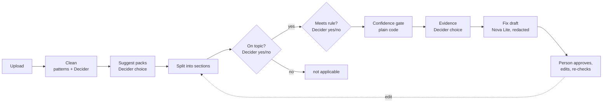

# Architecture

## Flow



Decider 2B answers small typed questions. The verdict, the threshold and what happens next are code.
Bedrock only writes text, and only for gaps.

## Packages

| Package | Responsibility | Main entry points |
|---|---|---|
| `shodhaka.decider` | HTTP client for `strands-decider serve` (`/v1/systemone`), plus `ScriptedDecider` for tests | `HttpDecider.ask(state, questions)` |
| `shodhaka.rules` | Rule packs: YAML + JSON schema, layering (`compose`), rules → questions, checks done in code | `load_pack`, `compose`, `relevance_question`, `compliance_question` |
| `shodhaka.documents` | Reading files, splitting into sections, cleaning at upload, redaction before Bedrock | `load_document`, `clean`, `remove_unsafe`, `Redactor` |
| `shodhaka.analysis` | Two-stage questions per section, the gate, design-set mode, evidence, pack suggestion, Bedrock fixes, reports | `analyze`, `gate`, `recommend`, `add_fixes` |
| `shodhaka.evaluation` | Scoring against `expected.json`, threshold calibration, review sheets, Decider vs LLM benchmark | `evaluate`, `calibrate`, `BedrockDecider` |
| `shodhaka.web` | FastAPI app for the UI; organizations, projects and analyses on disk | `create_app`, `Workspace` |
| `shodhaka.cli` | The `shodhaka` command | `main` |

Dependencies point one way: `web` and `cli` use `analysis` and `evaluation`, which use `rules`,
`documents` and `decider`. Nothing below `web` depends on FastAPI.

## Key decisions

**Two yes/no questions instead of one choice.** "Is this section about X?" for all rules in one request,
then "does it meet X?" only for the rules it is about. Off-topic sections stop voting, and short topics
are recognised far better than long ones. On the tuning set this went from 58% to 90% exact accuracy.

**The gate is code.** A confident "breaks it" is a gap, anything below the threshold goes to a person,
and the best a finding can reach on its own is "covered, sign-off pending". Every per-section answer is
kept in the report, so `shodhaka calibrate` can re-score thresholds without calling the model.

**Rule scope.** `scope: section` (prohibitions) is a gap if any section breaks it. `scope: document`
(things that must be present) is met if any section meets it. The same two rules combine answers
across files when several documents form one design.

**Clean before anything reads it.** Secrets, personal data and prompt injections are removed at upload;
the analysis, exports, pack suggestion and Bedrock only see the cleaned copy. See [SECURITY.md](SECURITY.md).

**No database, no login.** The workspace is plain files, isolated by path:

```
out/ui/orgs/<org>/org.json
out/ui/orgs/<org>/packs/<pack>.yaml                          general packs
out/ui/orgs/<org>/projects/<project>/packs/<pack>.yaml       project packs (override by rule id)
out/ui/orgs/<org>/projects/<project>/analyses/<id>/          uploads, cleaned copies, report.json,
                                                             reviews.json, removals.json, rules.yaml
```

Each analysis keeps a snapshot of the rules it ran with, so editing a pack never changes an old report.

## UI

React 19 + Vite + TypeScript in `ui/`. Feature folders (`features/analysis`, `features/projects`, …),
a typed API client (`api/`), pure logic with unit tests (`domain/`) and hooks for polling, routing and
shortcuts (`hooks/`). The production build is served by `shodhaka serve`. Details in
[ui/README.md](ui/README.md).

## Tests

`pytest` runs the backend tests and the pattern tests with a scripted Decider, so no model or network
is needed. `cd ui && npx vitest run` runs the UI tests.
