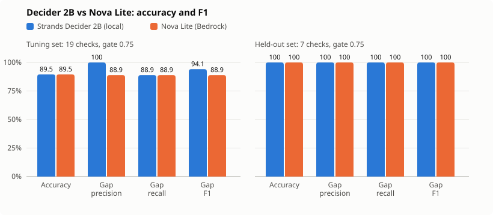
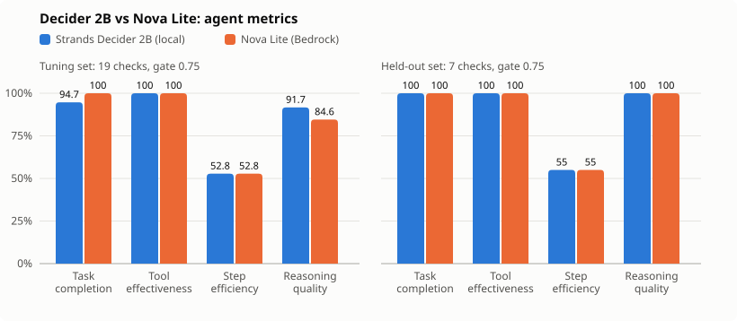
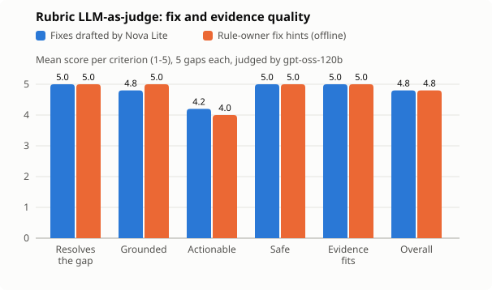

# Decider 2B vs Nova Lite

Same questions, same sections, same confidence gate (0.75) and scoring; only the model behind `ask()`
differs. Decider 2B ran locally on an Apple-silicon Mac; Nova Lite ran on Amazon Bedrock in
eu-central-1 (`eu.amazon.nova-lite-v1:0`). Run on 23 October 2026 with `shodhaka bench`.



Precision, recall and F1 treat "gap" as the positive class: precision is the share of reported
gaps that are real, recall the share of real gaps reported as gaps.

## Tuning set (`samples/acme-arch/visible`, 19 labelled checks)

| Metric | Strands Decider 2B (local) | Nova Lite (Bedrock) |
|---|---|---|
| Exact accuracy | 89.5% | 89.5% |
| Gap precision | 100.0% | 88.9% |
| Gap F1 | 94.1% | 88.9% |
| Gap recall (gap only) | 88.9% | 88.9% |
| Gap recall (gap or review) | 88.9% | 88.9% |
| False alarms | 0.0% | 11.1% |
| Escalated to a person | 5.3% | 0.0% |
| Requests | 34 | 34 |
| Latency p50 per request (ms) | 736 | 731 |
| Latency p95 per request (ms) | 1,138 | 919 |
| Wall time (s) | 42.1 | 26.5 |
| Input tokens | 14,017 | 13,798 |
| Output tokens | – | 2,496 |
| Cost, total (USD) | 0 | 0.001427 |
| Cost per 1,000 requests (USD) | 0 | 0.042 |

## Held-out set (`samples/acme-arch/heldout`, 7 labelled checks, never used for tuning)

| Metric | Strands Decider 2B (local) | Nova Lite (Bedrock) |
|---|---|---|
| Exact accuracy | 100.0% | 100.0% |
| Gap precision | 100.0% | 100.0% |
| Gap F1 | 100.0% | 100.0% |
| Gap recall | 100.0% | 100.0% |
| False alarms | 0.0% | 0.0% |
| Escalated to a person | 0.0% | 0.0% |
| Requests | 9 | 9 |
| Latency p50 per request (ms) | 748 | 847 |
| Latency p95 per request (ms) | 4,521 (first request, model warming up) | 1,324 |
| Wall time (s) | 10.1 | 8.3 |
| Cost per 1,000 requests (USD) | 0 | 0.042 |

## Agent metrics



A task is one labelled rule check on one document. Computed from the saved reports by
`src/shodhaka/evaluation/agent_metrics.py`:

| Metric | Definition | Tuning set: Decider / Nova Lite | Held-out: Decider / Nova Lite |
|---|---|---|---|
| Task completion rate | checks that ended in a final verdict (gap, covered, not applicable) without being handed to a person | 94.7% / 100% | 100% / 100% |
| Tool usage effectiveness | model requests that returned something usable (a reply that parses; for a reported gap, a quotable evidence sentence) | 100% / 100% | 100% / 100% |
| Step efficiency | requests saved against one request per rule and section (34 requests instead of 72; 9 instead of 20) | 52.8% / 52.8% | 55% / 55% |
| Reasoning quality | of the verdicts the model committed to (not escalated), the share that were right | 91.7% / 84.6% | 100% / 100% |

Completion and reasoning quality pull in opposite directions on purpose: Decider completed one
check fewer because the gate handed an unsure case to a person, and that is why more of the
verdicts it did commit to were right. Step efficiency is the same for both, because both answer
the same batched questions; the saving comes from the two-stage design, not from the model.

## Rubric LLM-as-judge: fixes and evidence

Verdicts have an answer key; the generated text does not. `shodhaka judge` asks a second model,
OpenAI gpt-oss-120b on Bedrock (a different vendor from Nova Lite, so no model grades its own
family), to score each gap's fix and evidence quote from 1 to 5. It compared Nova Lite's fixes with
the rule owner's own fix hints on the same 5 gaps of the tuning set. Evidence and fixes were
redacted before sending; 10 calls, 4,341 input and 3,802 output tokens.



| Criterion (1-5) | Fixes drafted by Nova Lite | Rule-owner fix hints (offline) |
|---|---|---|
| Resolves the gap | 5.00 | 5.00 |
| Grounded | 4.80 | 5.00 |
| Actionable | 4.20 | 4.00 |
| Safe | 5.00 | 5.00 |
| Evidence fits | 5.00 | 5.00 |
| **Overall** | **4.80** | **4.80** |

- The evidence sentences Decider picked scored 5 of 5 on every gap: the quotes show the problem.
- Nova Lite's fixes are a little more concrete than the hand-written hints (4.2 against 4.0) and
  once added a detail the evidence did not support (grounded 4.8). Overall they tie at 4.8: the
  fix text is a convenience, the value is in finding and proving the gap.
- Five gaps per side is a small sample; the rubric is in `src/shodhaka/evaluation/judge.py`.

## Reading it

- Accuracy, recall and median latency are a tie. F1 is not: 94.1% for Decider against 88.9% for
  Nova Lite, because Nova Lite reported one gap that was not there (precision 88.9%).
- Both missed the same gap (ARCH-05 in adr-003, the call to an external provider). Their other
  error differs: Decider was unsure about a rule that does not apply to adr-003 (confidence 0.749,
  just under the gate), so the case went to a person; Nova Lite flagged ARCH-02 in adr-001 as a gap
  with 0.9 confidence although the ADR meets it, a false alarm a reviewer has to dismiss.
- Nova Lite finished the batch faster and costs very little, but every section leaves the machine.
  Decider costs nothing per call and keeps documents local.
- These are small synthetic sets: a sanity check, not a leaderboard.

Reproduce:

```bash
shodhaka bench --pack rule-packs/acme-arch.yaml --docs samples/acme-arch/visible \
  --expected samples/acme-arch/visible/expected.json --out out/bench/visible --send-to-bedrock
shodhaka bench --pack rule-packs/acme-arch.yaml --docs samples/acme-arch/heldout \
  --expected samples/acme-arch/heldout/expected.json --out out/bench/heldout --send-to-bedrock
python scripts/plot_results.py out/bench/visible out/bench/heldout --out docs/results/accuracy-f1.svg
shodhaka run --pack rule-packs/acme-arch.yaml --docs samples/acme-arch/visible --out out/visible-bedrock --bedrock
shodhaka run --pack rule-packs/acme-arch.yaml --docs samples/acme-arch/visible --out out/visible-offline
shodhaka judge out/visible-bedrock/report.json out/visible-offline/report.json \
  --pack rule-packs/acme-arch.yaml --model openai.gpt-oss-120b-1:0 --region <region> --out out/judge
```

Each `bench` run also writes its own `bench.svg` next to `bench.md`.
